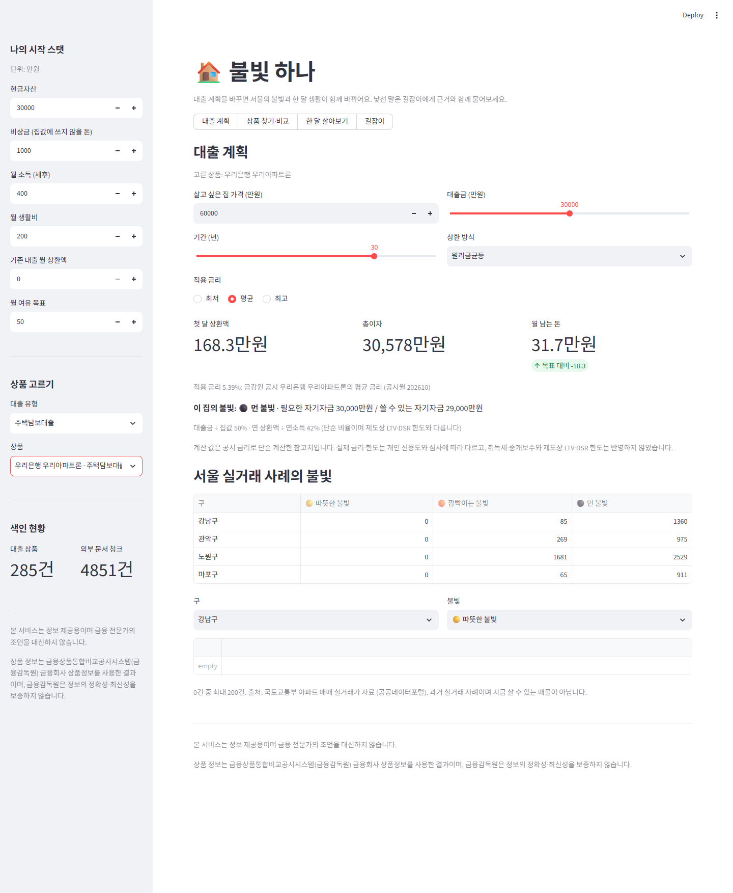
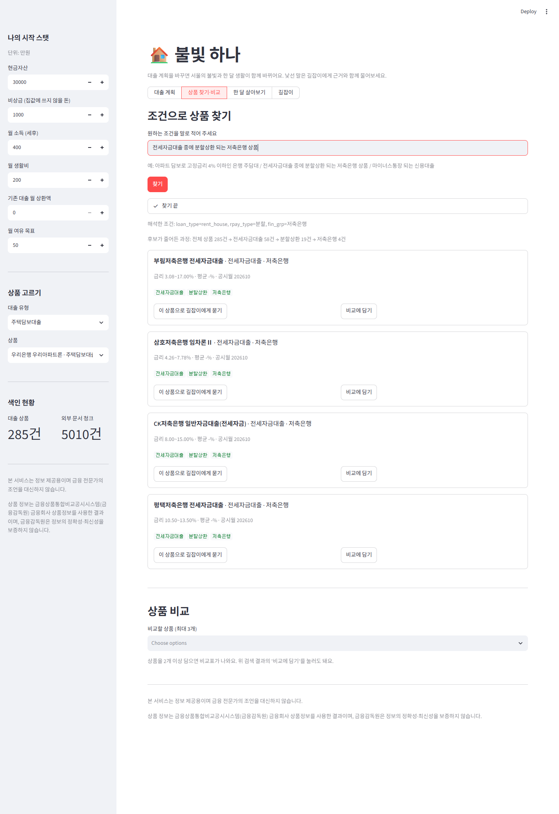
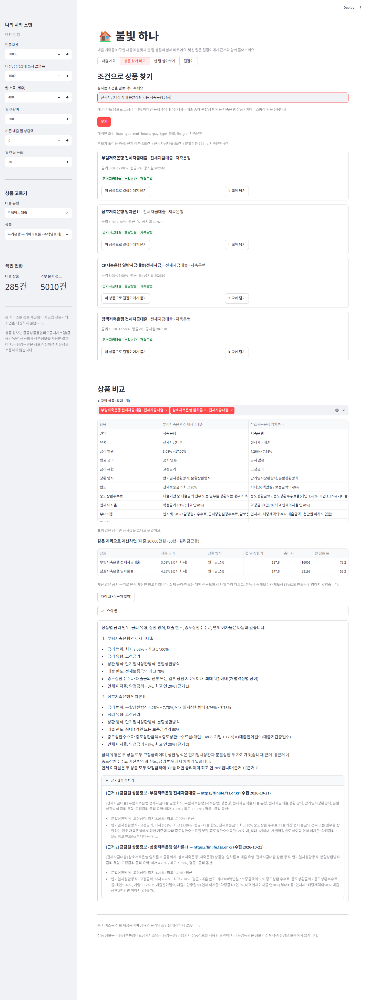
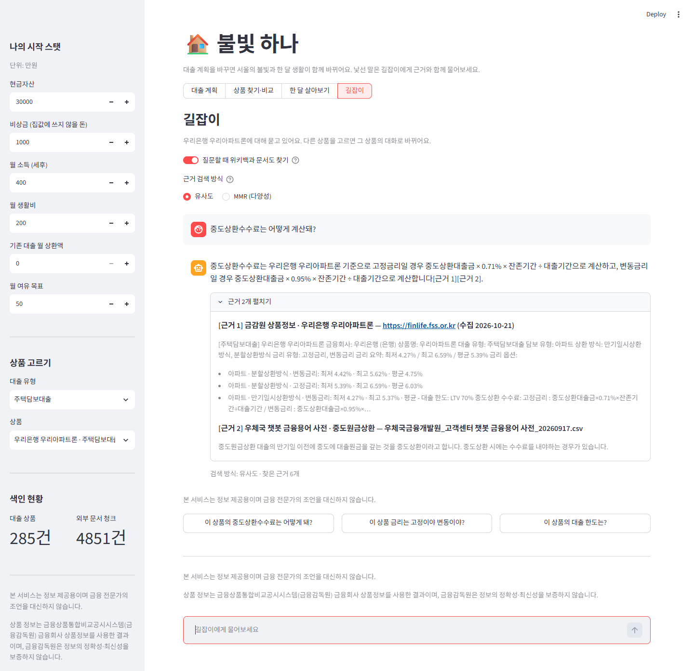

# 💡 불빛 하나 · fin-product-rag

> **서울의 불빛 하나, 내 집이 되기까지.**

서울 야경 위에서 내집마련 대출을 시뮬레이션하고, 대출 상품(주택담보·전세자금·개인신용)의 조건과 용어를 **근거와 함께** 설명하는 RAG 길잡이입니다. SSAFY AI 코어 프로젝트 2회차.

> 본 서비스는 정보 제공용이며 금융 전문가의 조언을 대신하지 않습니다.
> 상품 정보는 금융상품통합비교공시시스템(금융감독원) 금융회사 상품정보를 사용한 결과이며, 금융감독원은 정보의 정확성·최신성을 보증하지 않습니다.

## ✨ 기능
| | 화면 | 하는 일 |
|---|---|---|
| 🏠 | **대출 계획** | 집값·대출금·기간·금리로 월 상환액과 남는 돈 계산, 살 수 있는 집(실거래 사례)에 불빛 |
| 🗓️ | **한 달 살아보기** | 월급 → 생활비 → 상환 → 남은 돈을 한눈에 |
| 🔎 | **상품 찾기·비교** | "고정금리 4% 이하 전세대출" 같은 자연어 조건으로 찾고, 2~3개를 공시값 그대로 비교 |
| 🧭 | **길잡이** | 고른 상품과 대화. 금감원 공시·용어사전·위키백과를 근거로 `[근거 n]` 인용 답변 |

숫자(금리·상환액)는 코드가 공시값으로 계산하고, LLM은 설명과 요약만 씁니다.

## 📸 화면
| 대출 계획 | 상품 찾기 |
|---|---|
|  |  |
| **상품 비교** | **길잡이** |
|  |  |

상품 정보는 금융상품통합비교공시시스템(금융감독원) 금융회사 상품정보를 사용한 결과입니다. 검증용 전체 캡처 목록은 [검증 결과](docs/03_검증결과.md) 부록에 있습니다.

## 🧱 구조
```
app.py           Streamlit 진입점
config/          실행 설정(청크·Top-k·검색 방식), 평가 질문
src/data_prep/   금감원·위키·용어사전·실거래 수집
src/vectorstore/ loan_meta(상품 285건) · loan_docs(문서 약 5,000청크) 색인
src/rag/         LangGraph retrieve → generate, 프롬프트
src/services/    상환액·불빛 계산, 비교, 조건 탐색
src/ui/          화면 구성 요소
```

## 🚀 실행
```bash
python -m venv .venv && .venv\Scripts\activate      # macOS/Linux: source .venv/bin/activate
pip install -r requirements.txt
copy .env.example .env                               # 키 채우기 (GMS·금감원·국토부·위키 User-Agent)

python -m src.data_prep.fss_collector                # 금감원 대출상품 수집
python -m src.vectorstore.index_meta                 # 상품 색인
python -m src.vectorstore.index_docs --glossary      # 용어사전·PDF 색인 (파일은 data/raw/docs/)
python -m src.data_prep.molit_collector              # (선택) 서울 실거래 사례
streamlit run app.py                                 # 화면

python -m pytest -q                                  # 테스트 (네트워크·키 불필요)
```
옵션과 확인 방법은 [실행 가이드](docs/05_실행가이드.md), 제출 zip은 `python scripts/make_submission.py --region … --cls … --name …`.

## 📚 문서
[요구사항 정의서](docs/01_요구사항정의서.md) · [RAG 설계](docs/02_RAG_파이프라인_설계문서.md) · [검증 결과](docs/03_검증결과.md) · [구현 매핑](docs/04_요구사항_구현매핑.md) · [실행 가이드](docs/05_실행가이드.md) · [트러블슈팅](docs/06_트러블슈팅.md) · [출처·이용 조건](sources.md) · [작업 규칙](CLAUDE.md)
